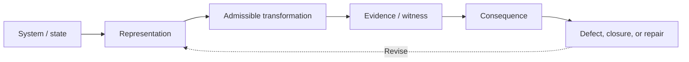

# Boundary First Labs

**Trace what follows. Design for repair.**

*Research and engineering for consequential systems.*

> **We study the boundaries where systems become real.**

Boundary First Labs is an independent, founder-led research and engineering laboratory investigating how systems are represented, transformed, observed, verified, and repaired—and how their consequences extend beyond the models used to describe them.

Our work connects established mathematics, computer science, formal methods, and systems engineering with original constructions, comparative research, and executable instruments. We aim to make consequential assumptions visible, preserve evidence, detect defects, and maintain paths to justified repair.

[Website](https://boundaryfirstlabs.com/) · [Intellectual provenance](INTELLECTUAL_PROVENANCE.md) · [Publication standards](PUBLICATION_POLICY.md) · [Licensing](LICENSING.md)

## The practical question

Every useful model preserves some distinctions and omits others. The problem begins when something it omits matters to a decision, a transformation, or someone who bears the consequence.

**Boundary First** asks:

- What system, purpose, and state are being represented?
- What distinctions, boundaries, interfaces, constraints, and invariants matter?
- Which transformations are permitted, and under which assumptions?
- What information, evidence, or dependency is lost when the representation changes?
- What can be witnessed, checked, challenged, and repaired?
- What consequences extend beyond the model's declared scope?

A compact working sequence is:

**Represent the state. Make the rules explicit. Transform carefully. Trace the consequences.**

This is an engineering and research orientation, **not a claim that every domain shares one mathematical ontology or that established techniques originated at BFL**.

## What the Lab studies and builds

- **Consequential systems architecture:** representations, state changes, interfaces, authority, dependencies, evidence, and repair across computational and institutional settings.
- **Software Before Code:** make domain constraints, invariants, and failure modes legible before treating implementation as the whole problem.
- **Formal and mathematical research:** examine constructions and relationships across native mathematical disciplines, preserving prior art and domain-specific standards.
- **Research instrumentation:** develop executable demonstrations, verification procedures, provenance records, and tools for identifying representational failures.
- **Public knowledge tools:** help people inspect claims, systems, and evidence; public analysis is not a substitute for appropriate domain expertise.

The Lab's potential contribution may be a construction, relation, integration, proof, counterexample, implementation, or useful diagnostic—not necessarily a newly discovered mathematical object. Each claim is evaluated separately.

## Inherited foundations vs. BFL contribution

**What we inherit:** existing mathematics, scientific results, software and systems theory, professional practice, and prior authors' work.

**What we develop:** particular compositions, explanations, computational instruments, research hypotheses, architectures, and proposed methods. Originality, correctness, and usefulness require their own evidence and comparisons.

**What we establish:** only the bounded results supported by explicit proofs, tests, sources, or independent checking. A shared diagram or vocabulary is not proof of cross-domain equivalence.

See [Intellectual Provenance](INTELLECTUAL_PROVENANCE.md) for the required distinctions and [Publication Policy](PUBLICATION_POLICY.md) for release criteria.

## About this public repository

This is a curated **public presentation and distribution surface**. It is not a mirror of the governed internal research corpus. Initially it publishes the Lab's orientation and the rules for releasing later work; individual research results and software will be added only with their own provenance, maturity, and rights disclosures.

**Publication is not validation.** A public document may contain working definitions, experiments, hypotheses, negative results, or unresolved questions. Its availability does not elevate those claims into established theorems or empirically verified outcomes.

## Rights, criticism, and collaboration

No blanket open-source or Creative Commons license is granted by this initial release. Copyrightable expression, code, branding, third-party content, and mathematical facts have different legal treatment; see [Licensing and Rights](LICENSING.md). In particular, publication does not claim copyright ownership over mathematical principles or equations as such.

Corrections, counterexamples, prior-art references, and accessibility feedback are welcome. See [Contributing and Criticism](CONTRIBUTING.md). Do not post confidential material or sensitive personal information in public issues.

**Show your work.**

[boundaryfirstlabs.com](https://boundaryfirstlabs.com/)
