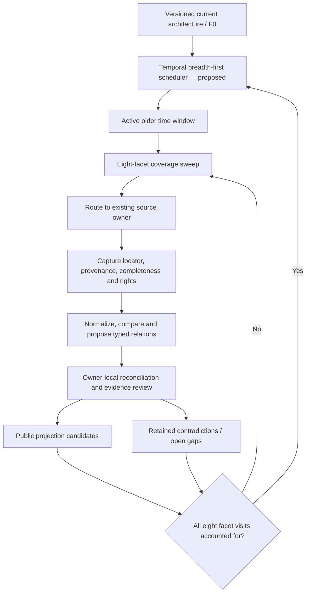

# RCBF-001 — Reverse-Chronological Breadth-First Recovery

**Version:** candidate v0.1 — 2026-11-23  
**Status:** proposed public-facing recovery and presentation protocol; not an implemented scheduler  
**Scope:** how Boundary First Labs selects, reconciles, and prepares its existing work for public explanation  
**Authority ceiling:** descriptive architecture and editorial/recovery plan only; no canonical research, product, publication, or runtime authority  
**Release posture:** public documentation candidate for review; not a release of historical source archives

> **Recover backward. Reconcile across. Publish forward. Preserve everything.**

## Purpose

Boundary First Labs has developed through longitudinal iterative refinement. Recent work can provide a more coherent architectural map of earlier investigations, but it does not automatically make newer interpretations true or invalidate older counterevidence.

Rather than reconstructing the Lab from its earliest records in depth-first order, this proposal begins with a **versioned contemporary architectural baseline** and recovers progressively older material in **chronological breadth-first cohorts** spanning the entire public portfolio.

The result is a public presentation that starts with today's best-supported explanations, provides backward navigable provenance, and improves through controlled historical reconciliation.

This is a **semantic rebase of the presentation**, **not** a Git-history rewrite, retroactive change of authorship, or promotion of historical hypotheses.

## 1. Three independent layers

1. **Historical preservation:** source material remains under its existing archival and research ownership. Original claims, failed tests, abandoned ideas, prior wording, and context are not silently changed.
2. **Architectural reconciliation:** earlier artifacts are related to contemporary constructs using reviewable, typed, evidence-backed edges. Uncertain mappings remain candidate mappings.
3. **Public projection:** cleared summaries, demonstrations, illustrations, evidence and corrections are compiled for readers. Public presentation does not own the underlying scientific truth.

Public repository content must obey [ADR-0001](decisions/ADR-0001-public-information-architecture.md), [ADR-0003](decisions/ADR-0003-public-history-and-recovery-firewall.md), [Publication Policy](../PUBLICATION_POLICY.md), and [Licensing](../LICENSING.md).

## 2. Frontier model

**Frontier 0 (F0): contemporary architectural baseline.** A dated, versioned, revisable index of the current concepts, governed source owners, demonstrations, and open questions. Existing recent diagrams (including numerical/type-tree and computational-structure graphs) are useful *candidate semantic maps*, not self-validating evidence.

**Frontier W1, W2, ...:** successively older time-bounded cohorts. Each cohort is surveyed across all eight public presentation facets before advancing the ordinary recovery cursor.

| Public presentation facet | Frontier-0 recovery focus |
| --- | --- |
| Public Codexware | Existing in-flight MVP and typed institutional-data analysis; recover its **actual implementation** rather than replace its scope |
| Paper Checking | Verification methods, source claims, evaluation plan and pilot status |
| Consequential Systems & Repair | Requirements, state/authority defects, dependency inversion and evidence-based repair |
| Software Before Code | Design contracts, requirements, formal checks and illustrative software cases |
| Boundary First UX | Common semantic identities across spatial, analytical and temporal views |
| Mathematics, Physics & Computation | Formal constructions, computational witnesses, proof obligations and unresolved obstructions |
| Economic Water Model | Bounded scenarios, kernel evidence, flow/access/capacity distinctions |
| AI Understanding, Explainability, Alignment & Governance | Representation sufficiency, interpretability, compositional safety, delegation and accountability |

These are **public presentation facets**, not new registered `PROD-*`, `RL-*`, or `REG-*` identities. A facet can contain research, software, applications and educational material at different maturities.

### Time ordering

Prefer **original creation or observation time** for a research item. Track separately its modification, commit, import, recovery, review and publication times.

- When timestamps conflict, retain the evidence and an uncertainty interval.
- Unknown-time sources enter a bounded undated queue; do not invent a chronology.
- Use variable-width windows: narrower for dense recent periods, broader for sparse earlier eras.
- Source accessibility and actual coverage are recorded separately from dates.

### Breadth-first invariant

For each window, record an outcome for **every** facet before moving the ordinary frontier backward:

`surveyed`, `partial`, `blocked`, or `not_found_in_accessible_sources`.

A survey outcome does **not** assert exhaustive recovery. Within each facet, use bounded owner-local traversal and stop when scope or review budget is exhausted.

**Evidence exception:** a missing older proof, source, benchmark or contradiction may require a targeted historical jump. Record its source frontier and return to the shared breadth frontier afterward.

## 3. Recovery pipeline

The scheduler is an **integration proposal**, not a claim that the existing Lab folder queue already implements chronological breadth-first ordering.

Reuse current canonical routing, semantic classification, bounded folder-transaction processing, conversation capture, research-exhaust reconciliation, publication controls and generators. Do not establish another authoritative registry or duplicate source objects simply to operate this public view.

## 4. Historical relationship semantics

Relationship suggestions require source references and declared confidence. Admission or promotion is the responsibility of the relevant source owner.

| Edge | Meaning |
| --- | --- |
| `precedes` | Demonstrably earlier; no semantic implication |
| `refines` | Later work supplies a more precise formulation |
| `supersedes` | Reviewed successor replaces an earlier active interpretation |
| `renames` | Identified same object under changed terminology |
| `generalizes` / `specializes` | Inclusion under stated assumptions and evidence |
| `supports` / `challenges` | Bounded supporting or conflicting evidence |
| `implements` | A specific executable realization |
| `illustrates` | Helpful exposition, **not** necessarily proof |
| `candidate_correspondence` | Plausible but unverified link |

Never infer equivalence merely from common vocabulary, matching graphics or a compelling retrospective narrative.

## 5. Minimal frontier work item

Each facet/window visit should be representable by a candidate **recovery record** (schema to be developed after the protocol is reviewed):

- `frontier_id`, `facet`, `window_start`, `window_end`, and `coverage_state`;
- exact source locators and source revisions, if available;
- original date and its certainty, distinct from ingestion or modification dates;
- `source_class` and `completeness` (lossless, visible span, retrieved excerpt, synthesis, unknown);
- current canonical owner or unresolved-owner marker;
- current architecture references, suggested typed edges and counterevidence;
- evidence class, claim ceiling, rights/disclosure restrictions, and publication eligibility;
- candidate demonstrations, reproduction steps, review tasks and remaining gaps.

The record is a **work/projection envelope**, not automatically a durable research object or central register identity.

## 6. Release and advancement gates

**Advance a recovery frontier** when the eight facet visits have recorded outcomes and unresolved work is preserved, even if no material is yet publishable.

**Approve a public projection** only after the correct source owner, current naming and claims, evidence limits, source rights, disclosure boundaries, corrections route and human review are established.

A positive code test is not an independent scientific result. A current diagram is not automatically a theorem. A recovered historical source is not current source authority.

Keep three separate measures:

1. **Breadth:** covered facet/window visits relative to the declared accessible source universe.
2. **Reconciliation:** recovered sources with reviewed ownership, identity and relationship dispositions.
3. **Public readiness:** individual artifacts passing their publication, rights and verification gates.

No metric implies the other two.

## 7. Public presentation contract

The public reader sees the **current supported explanation first** and may open:

`question → inputs → transformation → result → evidence → limits → correction → historical genealogy`

Public figures and demonstrations must distinguish historical reconstruction from current formal proof, local execution from independent replication, and intended features from running products.

The existing public Codexware MVP remains a separate, near-term implementation track. Full archival recovery is **not** a dependency of that MVP's bounded release.

## 8. Implementation sequence — proposed, not executed

**P0 — Freeze the interface baseline.** Review eight current-state cards, map the most recent source-backed demonstrations, and mark missing/uncertain implementation evidence.

**P1 — Pilot one chronological window.** Use existing owner routers and bounded folder transactions, account for all eight facets, record unknown dates and right-sized evidence exceptions.

**P2 — Reconcile.** Produce owner-scoped review packets and cross-facet relationship proposals; retain negative findings.

**P3 — Project.** Prepare reader-facing documents and demo references; pass each artifact through the actual publication and rights controls.

**P4 — Repeat.** Only after wave coverage is accounted for, advance backward; regularly update the contemporary public view from reviewed state.

No execution, ingestion, publication promotion or private-source copying is authorized by this document.

## 9. Provenance and limits

**Origin:** founder-directed longitudinal recovery and launch-presentation design discussion, November 23, 2026.  
**Source class:** directly visible bounded conversation, informed by selected governed repository controls and earlier candidate summaries. **Not** a lossless historical transcript.  
**Source link:** intentionally not embedded in public text; a private ChatGPT conversation locator is not automatically cleared for public disclosure.  
**Research claim status:** operational proposal, not experimentally validated superiority of this scheduling policy.  
**Rights:** see repository [Licensing](../LICENSING.md); public availability does not grant reuse permissions.  
**Correction route:** [Contributing and Criticism](../CONTRIBUTING.md); changes and supersessions should be recorded in [public history](../history/README.md).

**Current governing distinction:** the public repository is a downstream projection. The private Lab remains the authority for its source research and historical corpus.

**One sentence:** *Traverse backward through the history of discovery while building forward from the current state of understanding.*
