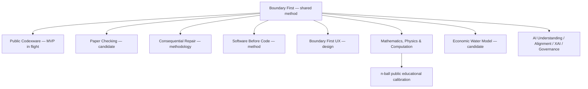

# Demonstration Atlas — Frontier 0

**Status:** candidate public visualization and source-catalog design, not an operating web app  
**Baseline:** 2026-11-23 · [RCBF-001 protocol](../REVERSE_CHRONOLOGICAL_BREADTH_FIRST_RECOVERY.md) · [Manifest](manifest.json)

## Visitor-oriented overview

The Lab's eight public presentation facets are distinct **routes** into shared research and engineering practice, not eight equally mature public products.

| Facet | Proposed reader experience | Confirmed public release status |
| --- | --- | --- |
| Public Codexware | Inspect an individual–institutional data question and export the calculation's evidence | Current MVP reported in flight; public release **not verified** |
| Paper Checking | See claims, supporting evidence, proof obligations and explicit unknowns | Service/pilot **not established as publicly executed** |
| Consequential Systems & Repair | Trace a systems defect and check a bounded repair | No cleared public case package identified |
| Software Before Code | Walk requirements → invariants → contracts → verified implementation | No cleared public method demo package identified |
| Boundary First UX | Explore a common semantic object in multiple representations | No cleared BFUX demo package identified |
| Mathematics, Physics & Computation | Explore a geometrical construction and an explicit representation-loss counterexample | [Public n-ball educational calibration](../../projects/n-ball-boundary-recursion/README.md) is published; not a new theorem |
| Economic Water Model | Replay a synthetic flow/access/capacity scenario | No public executable package identified |
| AI Understanding, Explainability, Alignment & Governance | Contrast prediction, representation, explanation and delegated authority | No general LLM mechanism or alignment breakthrough claimed |

The n-ball project is the only **public project-package evidence anchor verified for this initial atlas**. The other facets are meaningful launch candidates, not fake clickable demos.

## Public architecture map

Arrows above mean **public narrative grouping and discoverability only**. They are not evidence of mathematical implication, project dependency, independent validation, or formal compositional equivalence.

## Read-only atlas contract

A future D3 or browser renderer may consume the `manifest.json` as a **static, versioned input**. It must:

1. Preserve node identity, exact source/evidence links, public status and claim ceilings across views.
2. Show *not released*, *candidate*, *educational exposition*, and *verified result* as distinct concepts.
3. Allow navigation by facet, availability, research status and chronology without manufacturing missing evidence.
4. Keep historical research relationships in a separate visual layer from mere navigation edges.
5. Treat candidate relationships as uncertain; an aesthetically convincing link is not a verified dependency.
6. Use only publicly approved links/bytes, never invent a route or expose unapproved private source locators.
7. Avoid all consequential external actions; inspecting, searching and exporting public documentation are the intended actions.
8. Maintain a correction route, keyboard accessibility, readable non-graph fallback, and deterministic data-version labels.

**No D3 interface or live kernel is represented as deployed by this document.**

## Testable acceptance checks for the next implementation

- All eight facets are present exactly once and every navigation edge has resolvable public atlas endpoints.
- A clicked *published* object resolves to an existing public owner and release manifest.
- Candidate objects remain explicitly unreleased; visual effects do not alter their claim status.
- Changing facets preserves node identity and releases' recorded rights/status.
- A viewer can tell that a published educational project is **not** an executable service or validated theorem.
- No public manifest contains a private ChatGPT conversation URL, internal source dump or unapproved attachment.
- Chronological windows distinguish source creation, modification, import and publication dates.

## Next pass

Select one time-bounded newest-first cohort, recover the eight **owner-scoped** visit outcomes, and bind only reviewed public-safe outputs into this graph. The first targeted exception is the actual Codexware MVP: verify rather than reimplement it.
